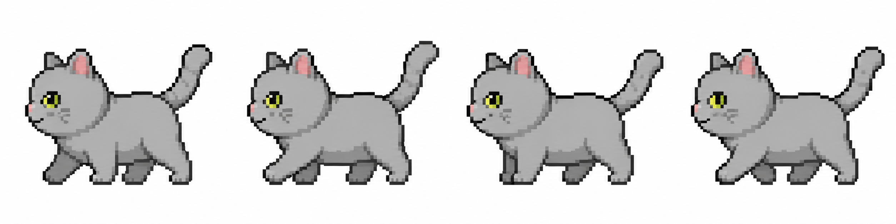

# 🐱 Pixel Cat — แมวพิกเซลน้อยบนหน้าจอ

แมวพิกเซลน่ารัก ๆ ที่จะเดินเล่น นั่ง นอน กินข้าว ไปมาอยู่บนหน้าจอคอมพิวเตอร์ของคุณ
ใช้ได้ทั้ง **macOS (เครื่อง Mac)** และ **Windows (เครื่องวินโดวส์)**



> คู่มือนี้เขียนสำหรับ **คนที่ไม่ใช่สายเทคนิค** อ่านตามทีละขั้น ทำตามได้เลยครับ 🙂

---

## ⭐ วิธีที่ 1 (ง่ายที่สุด): ให้ Claude ติดตั้งให้ทั้งหมด

ถ้าคุณใช้ **Claude** อยู่ (เช่น Claude Code หรือ Claude ที่สั่งให้ทำงานในเครื่องได้) วิธีนี้ง่ายที่สุดเลยครับ —
**ไม่ต้องลง Python เอง ไม่ต้องพิมพ์คำสั่งอะไรเลย** แค่ก็อปข้อความข้างล่างนี้ทั้งหมด เอาไปวางให้ Claude
แล้ว Claude จะจัดการให้ทุกอย่างเอง ตั้งแต่ลง Python ไปจนเปิดแมวให้เดินบนหน้าจอ

> 📋 **ก็อปข้อความในกรอบนี้ทั้งหมด แล้ววางส่งให้ Claude:**

```text
ช่วยติดตั้งและเปิดโปรแกรม "Pixel Cat" บนเครื่องนี้ให้หน่อย ทำให้จบในครั้งเดียวโดยที่ฉันไม่ต้องพิมพ์อะไรเพิ่ม:

1. ตรวจดูก่อนว่าเครื่องนี้เป็น macOS หรือ Windows
2. ถ้ายังไม่มี Python ให้ติดตั้ง Python 3 ให้ก่อน
   - ถ้าเป็น macOS ให้ใช้ Homebrew (ถ้ายังไม่มี Homebrew ก็ติดตั้ง Homebrew ให้ด้วย)
   - ถ้าเป็น Windows ให้ใช้ winget
3. ถ้ายังไม่มี git ให้ติดตั้ง git ให้ด้วย
4. โคลนโค้ดจาก https://github.com/Boom-Vitt/claude-pixel-cat
5. เข้าไปในโฟลเดอร์นั้น สร้าง virtual environment ชื่อ .venv แล้วติดตั้งไลบรารีจาก requirements.txt
6. เปิดโปรแกรมด้วยการรันไฟล์ pixel_cat.py โดยใช้ Python ที่อยู่ใน .venv
7. ถ้ามี error ให้แก้ให้เรียบร้อยจนกว่าแมวพิกเซลจะเดินออกมาบนหน้าจอได้สำเร็จ
8. สุดท้าย บอกฉันสั้น ๆ ว่าครั้งต่อไปจะเปิดแมวซ้ำได้ยังไง และถ้าฉันอยากให้แมวเปิดเองอัตโนมัติทุกครั้งที่เปิดเครื่อง ให้รัน install_autostart.py ให้เลย
```

รอสักครู่ เดี๋ยวแมวก็จะเดินออกมาเองครับ 🐱🎉

> 💡 วิธีนี้ต้องใช้ Claude ที่สั่งรันคำสั่งในเครื่องได้จริง (เช่น **Claude Code**) ถ้าใช้ไม่ได้ ให้ข้ามไปทำ **วิธีที่ 2** ด้านล่างแทน

---

## 🛠️ วิธีที่ 2: ติดตั้งเอง (ถ้าไม่ได้ใช้ Claude)

ถ้าไม่ได้ใช้ Claude ก็ทำเองได้ ไม่ยากครับ — ลง Python ครั้งเดียว แล้วก็อปคำสั่งเดียวไปวาง

### 📋 สิ่งที่ต้องเตรียมก่อน (ทำครั้งเดียว)

โปรแกรมนี้ทำงานด้วยภาษา **Python** เพราะฉะนั้นต้องลง Python ในเครื่องก่อน 1 ครั้ง

### ▶️ ถ้าใช้ Mac (macOS)

1. เปิดเว็บ 👉 https://www.python.org/downloads/
2. กดปุ่มสีเหลือง **"Download Python"** (เวอร์ชันล่าสุด)
3. เปิดไฟล์ที่โหลดมา แล้วกด **Next / Continue** ไปเรื่อย ๆ จนติดตั้งเสร็จ
4. เสร็จแล้ว ✅ (Mac รุ่นใหม่ส่วนใหญ่มี Python ติดมาอยู่แล้ว แต่ลงเพิ่มไว้จะชัวร์กว่า)

### ▶️ ถ้าใช้ Windows (วินโดวส์)

1. เปิดเว็บ 👉 https://www.python.org/downloads/
2. กดปุ่มสีเหลือง **"Download Python"** (เวอร์ชันล่าสุด)
3. เปิดไฟล์ที่โหลดมา
4. ⚠️ **สำคัญมาก!** ก่อนกดติดตั้ง ให้ **ติ๊กถูก ✅ ที่ช่อง "Add Python to PATH"** ด้านล่างสุดของหน้าต่างก่อน
5. แล้วค่อยกด **"Install Now"** รอจนเสร็จ ✅

> ❗ ถ้าลืมติ๊ก "Add Python to PATH" โปรแกรมจะหาไม่เจอ ต้องลงใหม่และติ๊กให้เรียบร้อย

### 🚀 ก็อปคำสั่งเดียวไปวาง แล้วแมวจะออกมา

ลง Python เสร็จแล้ว ก็มาต่อขั้นตอนนี้ — **คัดลอกคำสั่งด้านล่างไปวางแค่ "ชุดเดียว" แล้วกด Enter** เดี๋ยวแมวก็จะโผล่มาเองครับ

### 🍎 สำหรับ Mac (macOS)

**ขั้นที่ 1:** เปิดโปรแกรมชื่อ **Terminal**
- กดปุ่ม `Command (⌘)` + `Spacebar` พร้อมกัน
- พิมพ์คำว่า `Terminal` แล้วกด `Enter`

**ขั้นที่ 2:** คัดลอกคำสั่งข้างล่างนี้ทั้งหมด เอาไปวางในหน้าต่าง Terminal แล้วกด `Enter`

```bash
git clone https://github.com/Boom-Vitt/claude-pixel-cat.git && cd claude-pixel-cat && python3 -m venv .venv && .venv/bin/python -m pip install -r requirements.txt && .venv/bin/python pixel_cat.py
```

**ขั้นที่ 3:** รอสักครู่ (ครั้งแรกอาจนานหน่อยเพราะต้องโหลดของ) แล้วแมวจะเดินออกมาที่มุมจอ 🐱🎉

> 💡 **อย่าเพิ่งปิดหน้าต่าง Terminal** ระหว่างที่ใช้งานแมวนะครับ ถ้าปิด แมวจะหายไปด้วย
> (ถ้าอยากให้แมวเปิดเองทุกครั้งที่เปิดเครื่อง โดยไม่ต้องเปิด Terminal ดูหัวข้อ ["เปิดแมวอัตโนมัติ"](#-เปิดแมวอัตโนมัติทุกครั้งที่เปิดเครื่อง-ไม่บังคับ) ด้านล่าง)

---

### 🪟 สำหรับ Windows (วินโดวส์)

**ขั้นที่ 1:** เปิดโปรแกรมชื่อ **PowerShell**
- กดปุ่ม `Windows` ที่มุมซ้ายล่าง
- พิมพ์คำว่า `PowerShell`
- กดที่ **Windows PowerShell** เพื่อเปิด

**ขั้นที่ 2:** คัดลอกคำสั่งข้างล่างนี้ทั้งหมด เอาไปวางในหน้าต่าง PowerShell แล้วกด `Enter`

```powershell
git clone https://github.com/Boom-Vitt/claude-pixel-cat.git; cd claude-pixel-cat; py -m venv .venv; .\.venv\Scripts\python.exe -m pip install -r requirements.txt; .\.venv\Scripts\python.exe pixel_cat.py
```

**ขั้นที่ 3:** รอสักครู่ (ครั้งแรกอาจนานหน่อยเพราะต้องโหลดของ) แล้วแมวจะเดินออกมาที่มุมจอ 🐱🎉

> 💡 **อย่าเพิ่งปิดหน้าต่าง PowerShell** ระหว่างที่ใช้งานแมวนะครับ ถ้าปิด แมวจะหายไปด้วย
> (ถ้าอยากให้แมวเปิดเองทุกครั้งที่เปิดเครื่อง ดูหัวข้อ ["เปิดแมวอัตโนมัติ"](#-เปิดแมวอัตโนมัติทุกครั้งที่เปิดเครื่อง-ไม่บังคับ) ด้านล่าง)

> ⚠️ ถ้าขึ้นว่าไม่รู้จักคำสั่ง `git` แสดงว่ายังไม่มีโปรแกรม Git ในเครื่อง — ติดตั้งได้ที่ 👉 https://git-scm.com/download/win (กด Next ไปเรื่อย ๆ จนเสร็จ) แล้วลองวางคำสั่งใหม่อีกครั้ง

---

## 🎮 วิธีใช้งานแมว

เมื่อแมวออกมาแล้ว แมวจะ **เดินเล่นไปมาเอง** สลับกับนั่ง นอน กินข้าว เข้าห้องน้ำ เป็นวงจรไปเรื่อย ๆ
และจะมี **ลูกโป่งคำพูดน่ารัก ๆ** เช่น "meow!", "purr...", "feed me?" โผล่ขึ้นมาด้วย

> 🐾 แมวจะ **ลอยอยู่เหนือทุกแอป** และเดินเล่นต่อไปเรื่อย ๆ ถึงแม้คุณจะคลิกไปทำงานในแอปอื่น (เปิดเว็บ พิมพ์งาน ดูหนัง) แมวก็จะยังอยู่บนหน้าจอ **จนกว่าคุณจะสั่งปิดเอง** (เมนู Quit Pixel Cat) — ใช้ได้ทั้งบน Mac และ Windows

### กดที่ตัวแมว
- **คลิกที่ตัวแมว** → แมวจะพูดว่า "play!" และหยุดเดินแป๊บนึง

### ปุ่มควบคุมแมว (ไอคอนแมวเล็ก ๆ)
มองหาไอคอนแมวตัวเล็ก ๆ ที่:
- **Mac** → อยู่บน **แถบเมนูด้านบนขวา** ของจอ (ข้าง ๆ นาฬิกา)
- **Windows** → อยู่ที่ **มุมขวาล่าง** ของจอ (ในถาดไอคอน ข้าง ๆ นาฬิกา — อาจต้องกดลูกศร `^` เพื่อดูไอคอนที่ซ่อนอยู่)

**คลิกที่ไอคอนแมว** จะมีเมนูให้เลือก:

| เมนู | ความหมาย |
|------|-----------|
| **Walk** | สั่งให้แมวเดิน |
| **Sit** | สั่งให้แมวนั่ง |
| **Lie Down** | สั่งให้แมวนอน |
| **Eat** | สั่งให้แมวกินข้าว |
| **Poop** | สั่งให้แมวเข้าห้องน้ำ |
| **Auto Mode: ON / OFF** | เปิด/ปิดโหมดอัตโนมัติ (ถ้าปิด แมวจะอยู่ท่าเดิมไม่เปลี่ยนเอง) |
| **Quit Pixel Cat** | 🛑 **ปิดแมว / เลิกใช้งาน** |

---

## 🛑 วิธีปิดแมว

ทำได้ 2 วิธี:
1. คลิกที่ไอคอนแมว (แถบเมนูบน Mac / มุมขวาล่างบน Windows) แล้วเลือก **Quit Pixel Cat**
2. หรือกลับไปที่หน้าต่าง Terminal / PowerShell ที่เปิดแมวไว้ แล้วกด `Control (Ctrl)` + `C`

---

## 🔁 เปิดแมวอัตโนมัติทุกครั้งที่เปิดเครื่อง (ไม่บังคับ)

ถ้าอยากให้แมวโผล่มาเองทุกครั้งที่เปิดเครื่อง โดยไม่ต้องมานั่งพิมพ์คำสั่งเอง ให้ทำขั้นตอนนี้ **ครั้งเดียว**

> ต้องอยู่ในโฟลเดอร์ `claude-pixel-cat` ก่อน — ถ้าเพิ่งติดตั้งเสร็จ ก็อยู่ในนั้นอยู่แล้ว

### 🍎 บน Mac
วางคำสั่งนี้ใน Terminal แล้วกด Enter:
```bash
.venv/bin/python install_autostart.py
```

### 🪟 บน Windows
วางคำสั่งนี้ใน PowerShell แล้วกด Enter:
```powershell
.\.venv\Scripts\python.exe install_autostart.py
```

ทีนี้แมวจะเปิดเองอัตโนมัติหลังจากที่คุณ login เข้าเครื่องทุกครั้ง 🎉

### ❌ ถ้าไม่อยากให้เปิดเองแล้ว (ยกเลิก)
**บน Mac:**
```bash
.venv/bin/python uninstall_autostart.py
```
**บน Windows:**
```powershell
.\.venv\Scripts\python.exe uninstall_autostart.py
```

---

## ⚙️ ปรับแต่งแมว (สำหรับคนที่อยากลองเล่นเพิ่ม — ไม่บังคับ)

อยากได้แมวตัวใหญ่ขึ้น เดินเร็วขึ้น? ลองพิมพ์คำสั่งพวกนี้แทนตอนเปิดแมวได้

### 🍎 บน Mac
```bash
# แมวตัวใหญ่ขึ้น (ค่าปกติคือ 128 ลองใส่ 160, 200 ดู)
PIXEL_CAT_SIZE=160 .venv/bin/python pixel_cat.py

# แมวเดินเร็วขึ้น (ค่าปกติคือ 2 ลองใส่ 3, 4 ดู)
PIXEL_CAT_SPEED=3 .venv/bin/python pixel_cat.py
```

### 🪟 บน Windows
```powershell
# แมวตัวใหญ่ขึ้น
$env:PIXEL_CAT_SIZE=160; .\.venv\Scripts\python.exe pixel_cat.py

# แมวเดินเร็วขึ้น
$env:PIXEL_CAT_SPEED=3; .\.venv\Scripts\python.exe pixel_cat.py
```

---

## ❓ ปัญหาที่พบบ่อย

**Q: พิมพ์คำสั่งแล้วขึ้นว่า `python3` / `py` / `git` not found หรือ "ไม่รู้จักคำสั่ง"**
- ➡️ แสดงว่ายังไม่ได้ติดตั้ง Python (หรือ Git) ให้ดูหัวข้อ ["สิ่งที่ต้องเตรียมก่อน"](#-สิ่งที่ต้องเตรียมก่อน-ทำครั้งเดียว) ด้านบน
- ➡️ **คน Windows:** มักเกิดจากตอนติดตั้ง Python **ลืมติ๊ก "Add Python to PATH"** — ให้ลง Python ใหม่และติ๊กช่องนั้นให้เรียบร้อย

**Q: แมวไม่โผล่ออกมาเลย**
- ➡️ ลองดูที่ **มุมขวาล่าง** ของจอ บางทีแมวเดินไปหลบอยู่ตรงนั้น
- ➡️ เช็กไอคอนแมวบนแถบเมนู (Mac) / มุมขวาล่าง (Windows) ว่ามีไหม ถ้ามีแสดงว่าแมวเปิดอยู่

**Q: เปิดเครื่องครั้งหน้าจะเปิดแมวยังไง?**
- ➡️ เปิด Terminal / PowerShell แล้วพิมพ์ตามนี้ (เข้าโฟลเดอร์ก่อน แล้วเปิดแมว):

  **Mac:**
  ```bash
  cd claude-pixel-cat && .venv/bin/python pixel_cat.py
  ```
  **Windows:**
  ```powershell
  cd claude-pixel-cat; .\.venv\Scripts\python.exe pixel_cat.py
  ```
- ➡️ หรือถ้าตั้งค่า ["เปิดแมวอัตโนมัติ"](#-เปิดแมวอัตโนมัติทุกครั้งที่เปิดเครื่อง-ไม่บังคับ) ไว้แล้ว แมวก็จะเปิดเองโดยไม่ต้องทำอะไร

---

## 📁 รายละเอียดทางเทคนิค (สำหรับนักพัฒนา)

โปรแกรมเขียนด้วย Python + [PySide6](https://doc.qt.io/qtforpython/) (Qt) และ [Pillow](https://python-pillow.org/)

ไฟล์ในโปรเจกต์:
```
pixel_cat.py            โปรแกรมหลัก
install_autostart.py    ติดตั้งให้เปิดเองตอน login
uninstall_autostart.py  ยกเลิกการเปิดเองตอน login
requirements.txt        รายการ library ที่ต้องใช้
cat-pixel1.png          ภาพแมวเดิน (sprite sheet 4 เฟรม)
cat-pixel2.png          ภาพแมวนั่ง
cat-pixel3.png          ภาพแมวนอนหงาย
cat-pixel4.png          ภาพแมวกินข้าว
cat-pixel5.png          ภาพแมวเข้าห้องน้ำ
site/                   หน้าเว็บแนะนำโปรเจกต์ (index.html)
```

sprite sheet แต่ละไฟล์ขนาด `512 x 128 px` แบ่งเป็น 4 เฟรม เฟรมละ `128 x 128 px` พื้นหลังสีขาวจะถูกทำให้โปร่งใสอัตโนมัติ

ตั้งค่าผ่าน Environment Variable ได้:
| ตัวแปร | ค่าปกติ | ความหมาย |
|--------|---------|-----------|
| `PIXEL_CAT_SIZE` | 128 | ความสูงของแมว (px) |
| `PIXEL_CAT_SPEED` | 2.0 | ความเร็วในการเดิน |
| `PIXEL_CAT_AUTO` | 1 | โหมดอัตโนมัติ (ใส่ `0` เพื่อปิด) |
| `PIXEL_CAT_SPEECH` | 1 | ลูกโป่งคำพูด (ใส่ `0` เพื่อปิด) |
| `PIXEL_CAT_HIDE_DOCK` | 0 | ซ่อนไอคอนใน Dock บน Mac (ใส่ `1` เพื่อซ่อน) |

ตำแหน่งไฟล์ autostart:
- **macOS:** `~/Library/LaunchAgents/com.local.pixelcat.desktoppet.plist`
- **Windows:** โฟลเดอร์ Startup ของผู้ใช้
